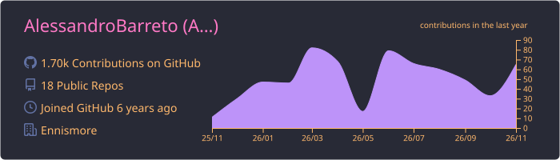
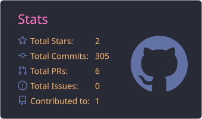
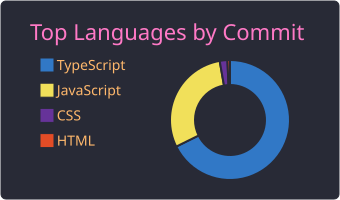
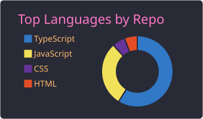
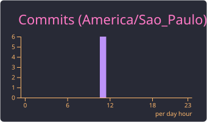

<h1 align="center">Hi there, I'm Alessandro Barreto 👋</h1>

  Frontend developer building with React, and growing into React Native and fullstack.

  
  
  
  

---

### 🚀 About me

- 🔭 Building a mobile **Expense Tracker** (Expo + Node.js + Fastify + PostgreSQL + Prisma)
- 🌱 Learning **React Native** and **fullstack** development
- 💼 Experienced with **React**, **Next.js** and **TypeScript**
- 🌐 Check out my work on my [portfolio](https://alessandro-barreto.netlify.app)

### 🛠️ Tech stack

  
  
  
  
  
  
  
  
  
  

### 📊 GitHub dashboard

  
  

  
  
  

### 🐍 Contributions

  <picture>
    <source media="(prefers-color-scheme: dark)" srcset="https://raw.githubusercontent.com/AlessandroBarreto/AlessandroBarreto/output/github-contribution-grid-snake-dark.svg">
    
  </picture>

